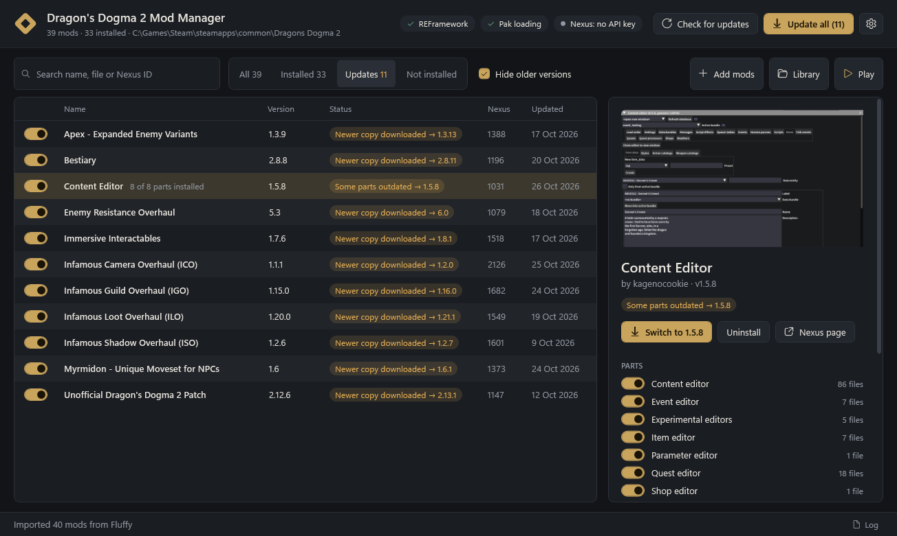

# DD2 Mod Manager

A Dragon's Dogma 2 mod manager that installs mods the way Fluffy Mod Manager does and keeps them updated from Nexus Mods.



## What it does

- **Fluffy-compatible installs.** Loose files (`reframework/…`, `natives/…`, DLLs) are copied into the game folder. Paks go to `pak_mods\x0000-Name.pak`, where the prefix sets load order. Archives with several `modinfo.ini` folders (e.g. Content Editor) show up as separate parts you can toggle individually. Original game files are backed up and restored on uninstall. Every install is all-or-nothing: if any step fails, it's rolled back. Files that several mods bundle (fonts, shared script libraries) are shared rather than conflicting, and stay on disk until the last mod that ships them is uninstalled.
- **Takes over an existing Fluffy setup.** On first run it finds Fluffy, reads `installed.ini`, and adopts what Fluffy installed, matching each entry to its archive by checking file sizes and CRCs against what's on disk. Nothing in the game folder changes. Your Fluffy `Mods` folder becomes the library.
- **Updates from Nexus.** Each archive is identified on Nexus by its MD5, falling back to the mod ID and upload time in the file name. The manager then follows the author's own "this file replaces that one" chain to find the newest version. With Premium, **Update** downloads the new file, swaps the installed version (keeping its pak load-order slot), and sends the old archive to the Recycle Bin.
- **Spots updates you already downloaded.** Older and newer archives of the same mod are grouped together, so a newer copy sitting in the library is offered as a one-click switch, even without a Nexus key.
- **"Mod Manager Download" button.** It can register as the `nxm://` handler. Clicking the button on Nexus downloads the file straight into the app and offers to install it, or to update the installed version.
- Checks that REFramework is installed and that its "Alternate PAK folder" option is on (without it DD2 ignores `pak_mods`). Refuses to touch paks, `natives` or DLLs while the game is running.

## First run

1. Run `publish\DD2ModManager.exe` (needs the .NET 8 Desktop Runtime, which comes with the SDK).
2. Accept the Fluffy import prompt. From then on, manage DD2 mods here instead of in Fluffy, or the two will disagree about what's installed.
3. Open **Settings**, paste your personal API key from <https://www.nexusmods.com/users/myaccount?tab=api>, and click **Test**.
4. Optional: click **Use this app** under "Mod Manager Download" links. This replaces the current handler (Mod Organizer 2's `nxmhandler.exe` on this PC), and **Restore previous** puts it back.

Settings has two update options: **Install updates automatically** (off by default) applies only the confident updates after each check. **Send replaced archives to the Recycle Bin** is on by default.

## How update detection decides

| Status | Meaning | Auto-installed? |
|---|---|---|
| Update → x | The author linked the new file to yours, or demoted yours and uploaded one with the same name | Yes, if auto-install is on |
| Newer copy downloaded / Some parts outdated | A newer archive of the same mod is already in the library | Yes |
| Possible update | Your file was retired and the newest main file is the best guess | No: asks first |
| Removed from Nexus | Your file is gone and nothing replaces it | – |

Update checks use the Nexus `updated.json` feed, so mods that haven't changed aren't re-fetched. A typical check costs a handful of API calls out of the 2,500-per-day allowance.

## Where things live

- `%APPDATA%\DD2ModManager\`: `settings.json` (API key encrypted with Windows DPAPI), `state.json` (installed files), `nexus-cache.json`, `log.txt`, and `Backup\` (original game files that mods replaced).
- The library defaults to Fluffy's `Games\DragonsDogma2\Mods` folder when one is found.

## Building

```
dotnet build DD2ModManager.sln
dotnet test tests/DD2ModManager.Tests
dotnet publish src/DD2ModManager -c Release -r win-x64 --self-contained false -p:PublishSingleFile=true -o publish
```

`tools/DD2ModManager.Cli` is a developer tool that never changes the game folder:

- `verify-fluffy <FluffyFolder>` checks the install rules against what Fluffy actually installed.
- `scan <library>` lists how each archive is read.
- `check-updates` runs a real Nexus check with the key saved in the app.

## Not done yet

- Reordering pak load order from the UI (it is preserved across updates, but new paks always go last).
- Nexus collections and FOMOD-style installers.
- Nexus SSO login. A personal API key is fine for personal use; sharing the app publicly would need registering it with Nexus.
